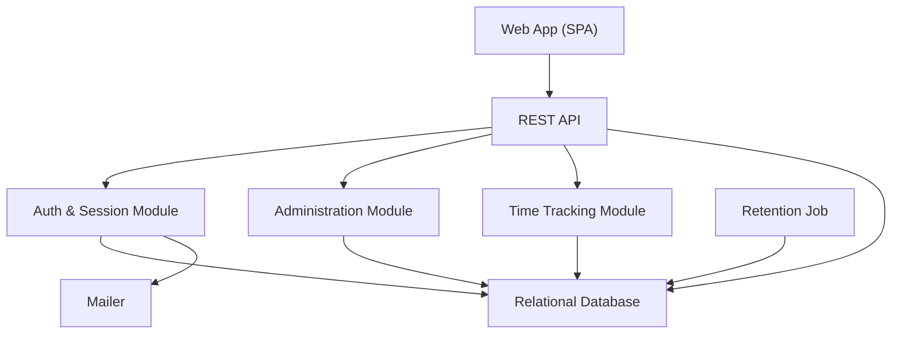
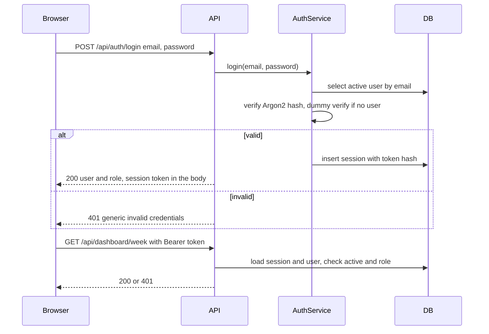
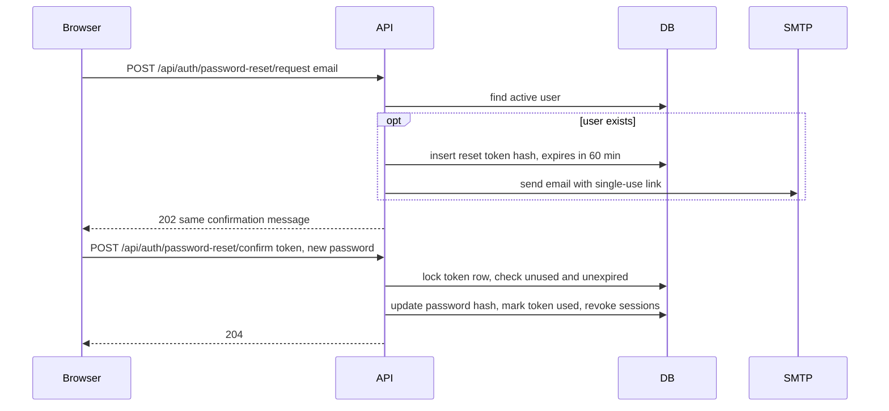
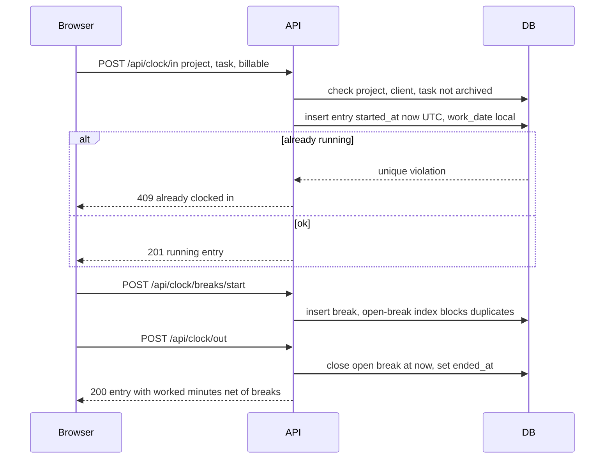
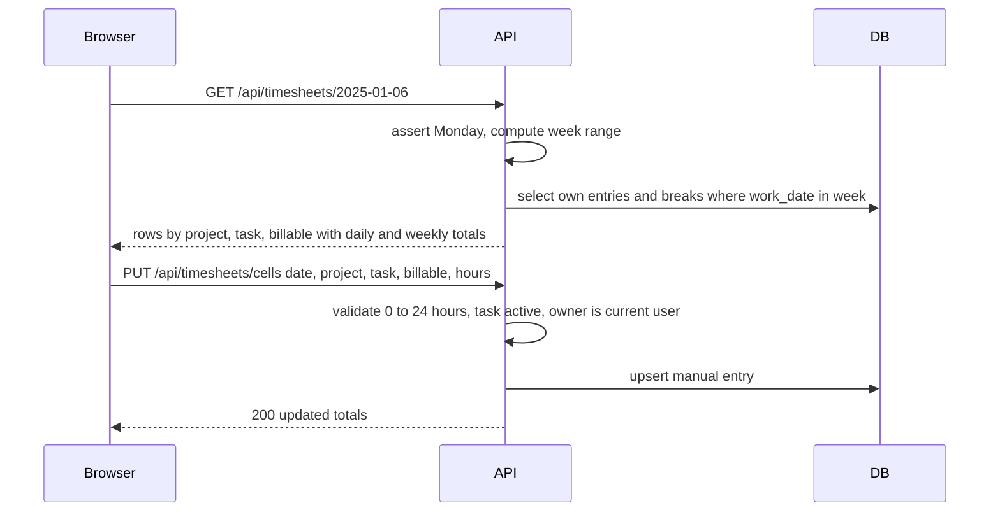
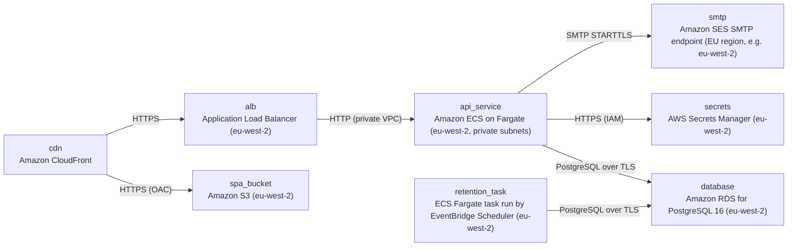

# Architecture

> Maintained by QuorQ AI SDLC. Text between `sdlc:auto` markers is regenerated; anything outside them is yours and is kept.

<!-- sdlc:auto:start narrative -->
## Overview

### ARCH-OVERVIEW · approved · source: architecture:summary

TimeTrack Pro V1 (Lightweight MVP) architecture, version 1, approved. It is a responsive React 19 SPA calling a FastAPI 0.115 REST API backed by PostgreSQL 16. Everything is hosted in AWS eu-west-2 (London) so personal data stays in the UK.

- Status: approved; Version: 1. No approval date given.
- Stack: React 19 (TypeScript) SPA -> FastAPI 0.115 REST API -> PostgreSQL 16.
- Hosting: AWS UK region eu-west-2 (London). Stated rationale: keep personal data in the UK, as GDPR and UK GDPR require.
- Auth: email and password sign-in.
  - Passwords hashed with Argon2.
  - Server-side sessions in HttpOnly, Secure, SameSite cookies.
  - Every request re-checks that the user is active and reads their role, so deactivation and role changes apply on the next request.
- Administration: System Admins manage users, manager assignments, clients, projects and tasks.
  - Projects carry an hourly bill rate used for reporting only.
- Time tracking: employees can clock in and out with breaks, or fill a Monday-to-Sunday weekly timesheet.
  - Each entry is charged to a project and task and marked billable or non-billable.
  - Employees can edit and delete their own entries and see a weekly dashboard.
- Time handling: all timestamps are stored in UTC and shown in each user's IANA time zone.
- Email: password-reset email goes through the approved SMTP service (Amazon SES SMTP, EU region).

**Related:** US-001, US-004, US-005, US-006, US-013, US-016

### ARCH-SCOPE · approved · source: architecture:summary

Architecture v1 covers only part of the project description. Approval, leave, labour rules, reports, payroll export, notifications and audit are outside this delivery and were not designed. Invoicing and payroll calculation are out of scope entirely.

In scope (designed):
- Authentication and password reset.
- User administration and manager assignment.
- Clients, projects (with bill rate) and tasks.
- Clock in/out with breaks.
- Weekly timesheet.
- Editing and deleting own entries.
- Weekly dashboard.
- Data retention job.
- Static user and admin help guides.

Outside this delivery scope (explicitly not designed):
- Timesheet approval.
- Time off / leave.
- Labour rules (overtime limits, minimum breaks, compliance report).
- Reports.
- Payroll export.
- Notifications.
- Audit.

Out of scope entirely:
- Invoicing.
- Payroll calculation.

Gaps against the project description (recorded for human follow-up, not resolved here):
- The description asks for timesheet approval and locking, leave requests and balances, overtime and break flagging, reports with CSV and payroll export, in-app notifications, and an audit trail. None of these is designed in v1.
- The description names four roles: Employee, Manager, Payroll Admin and System Admin. The architecture names System Admin and the manager role explicitly. It does not describe any Payroll Admin-specific capability.

### ARCH-RESIDENCY · approved · source: architecture:summary; architecture:deployment; architecture:tech:Cloud

Data residency in the UK under GDPR/UK GDPR is a stated driver of the architecture. The region wording differs across inputs and is recorded here as-is.

Version A (summary):
- 'Everything is hosted in an AWS UK region (eu-west-2 London) so personal data stays in the UK.'

Version B (mailer component and summary):
- Password-reset email uses 'Amazon SES SMTP in an EU region'.
- Deployment node smtp: 'EU region, e.g. eu-west-2'.

Version C (Cloud technology decision):
- Alternatives: 'None (residency met in eu-west-2 or eu-west-1)'.
- Services are 'available in the UK and EU regions, which meets NFR-006 and GDPR/UK GDPR'.

Additional observation:
- CloudFront is listed as an 'Edge distribution', not a eu-west-2 resource.

The input does not reconcile these versions. A human should confirm whether non-UK EU regions (for SES or otherwise) are acceptable under the residency requirement.

**Related:** NFR-006

### ARCH-COMP-WEB_SPA · approved · source: architecture:component:web_spa

Web App (SPA) built in React 19 with TypeScript. It provides the English-only responsive UI for every in-scope screen and converts UTC times to the user's time zone for display.

Screens covered:
- Sign-in.
- Password reset.
- Clock and breaks.
- Weekly timesheet.
- Dashboard.
- Admin screens: users, clients, projects and tasks.
- Static user and admin help guides.

Other responsibilities and properties:
- Converts UTC times to the user's time zone for display.
- English only.
- Deployed as a static build on S3 behind CloudFront (see ARCH-DEPLOY).

**Related:** US-001, US-013, US-016

### ARCH-COMP-API · approved · source: architecture:component:api

REST API built on FastAPI 0.115. It hosts the HTTP endpoints, validates requests with Pydantic, runs the cookie session middleware and enforces role-based access on the server for every request.

- Hosts all /api/* HTTP endpoints.
- Validates requests with Pydantic models.
- Runs the cookie session middleware.
- Enforces role-based access server-side on every request (NFR-003).
- Contains domain services for auth, users, catalog, clock and timesheet.

**Related:** NFR-003

### ARCH-COMP-AUTH_SERVICE · approved · source: architecture:component:auth_service

Auth & Session Module inside the FastAPI codebase. It handles login and logout, Argon2 hashing, server-side sessions, and single-use, time-limited reset and set-password tokens.

- Login and logout.
- Argon2 password hashing.
- Server-side sessions.
- Single-use, time-limited password-reset and set-password tokens.
- Returns generic error and confirmation messages (NFR-002).
- Revokes sessions when a user is deactivated.

**Related:** US-001, NFR-002

### ARCH-COMP-ADMIN_SERVICE · approved · source: architecture:component:admin_service

Administration Module. It manages user accounts and manager assignment, plus clients, projects and tasks. It never alters existing time entries.

- User accounts: create, edit, deactivate.
- Manager assignment: must point to an active user with the Manager role.
- Clients.
- Projects: hourly bill rate and default billable flag.
- Tasks: supports archiving.
- Never alters existing time entries (NFR-014).

**Related:** US-004, US-005, US-006, NFR-014

### ARCH-COMP-TIME_SERVICE · approved · source: architecture:component:time_service

Time Tracking Module. It handles clock in/out, breaks, fixing a running entry, manual weekly timesheet cells, editing and deleting own entries, and weekly dashboard aggregates.

- Clock in and out, breaks, and fixing a forgotten running entry.
- Manual weekly timesheet cells.
- Editing and deleting the user's own entries.
- Weekly dashboard aggregates.
- Computes durations in UTC.
- Derives local work dates from the user's time zone.
- Weeks run Monday to Sunday.

**Related:** US-013, US-016

### ARCH-COMP-MAILER · approved · source: architecture:component:mailer

Mailer that sends password-reset and set-password emails over SMTP through Amazon SES SMTP in an EU region.

- Implementation: Python smtplib.
- Server: Amazon SES SMTP endpoint, EU region.
- Configuration: approved SMTP_* settings. SMTP_USER and SMTP_PASSWORD are held in Secrets Manager.
- Emails sent: password reset; set password (on admin user creation).
- See ARCH-RESIDENCY for the region wording discrepancy.

**Related:** US-004

### ARCH-COMP-RETENTION_JOB · approved · source: architecture:component:retention_job

Scheduled retention job that deletes time entries and breaks older than the configured retention period (default 6 years).

- Implementation: CLI task in the FastAPI 0.115 codebase, using the same image as the API.
- Runs on AWS ECS Fargate, triggered daily by Amazon EventBridge Scheduler.
- Deletes time_entries and breaks older than the configured retention period.
- Default retention period: 6 years (NFR-008).

**Related:** NFR-008

### ARCH-COMP-DB · approved · source: architecture:component:db

PostgreSQL 16 on encrypted Amazon RDS is the system of record. Partial unique indexes enforce one running entry and one open break, and all timestamps are stored as UTC timestamptz.

- Engine: PostgreSQL 16 on Amazon RDS, encrypted.
- Stores: users, sessions, tokens, clients, projects, tasks, time entries, breaks and settings.
- Partial unique indexes enforce one running entry per user and one open break.
- All timestamps are stored as timestamptz in UTC.

### ARCH-CP-SIGNIN · approved · source: architecture:critical_path:sign-in

Critical path for sign-in and the per-request session check. Login gives the same error for an unknown email or a wrong password. Every request re-validates the session, the user's active status and their role from the database.

Login:
- Verifies the Argon2 hash.
- Returns the same error for an unknown email and for a wrong password.
- On success, creates a sessions row and sets an HttpOnly, Secure, SameSite=Strict cookie.

Every request:
- Loads the session and the user.
- Rejects the request if the session is revoked or expired, or the user is inactive.
- Reads the role fresh from the database, so admin changes take effect on the next request.

Note: the summary says 'SameSite'; this path specifies SameSite=Strict.

**Related:** US-001, NFR-002, NFR-003

### ARCH-CP-PWRESET · approved · source: architecture:critical_path:password-reset

Critical path for password reset by email. Uses single-use, hashed, 60-minute tokens, and confirmation revokes existing sessions in one transaction. The same mechanism handles the set-password link for new users.

Request:
- Always returns the same confirmation (AC-009).
- If an active account exists, stores the hash of a random token that expires after 60 minutes and emails a link.

Confirm:
- Checks that the token is unused and unexpired.
- Enforces the password rules. The rules themselves are not specified in the input.
- In one transaction: updates the password hash, marks the token used and revokes existing sessions.

Reuse: the same mechanism powers the set-password link sent when an admin creates a user.

**Related:** US-004, AC-009

### ARCH-CP-CLOCK · approved · source: architecture:critical_path:clock

Critical path for clock in, breaks and clock out. Database indexes guarantee one running entry and one open break. Worked minutes are computed in UTC so results stay correct across daylight-saving changes.

Clock-in:
- Checks that the project, client and task are active.
- Resolves the billable default.
- Inserts a clock entry with started_at = now() UTC and work_date = the local date in the user's time zone.
- A partial unique index rejects a second running entry with 409.

Break start:
- Inserts a break row.
- A partial unique index rejects a second open break.

Clock-out:
- Closes any open break at the clock-out time.
- Sets ended_at.

Calculation:
- Worked minutes = ended_at - started_at - sum of breaks, computed in UTC (DST-safe).

Forgotten entries:
- GET /clock/status flags a running entry that started on an earlier day.
- PATCH /time-entries/{id}/end validates that the end time is after the start time.

**Related:** AC-025, AC-026, AC-027, AC-028, AC-029, AC-030, AC-031, AC-032

### ARCH-CP-TIMESHEET · approved · source: architecture:critical_path:timesheet

Critical path for loading and saving the weekly timesheet. A Monday-to-Sunday view merges manual cells and clock entries with totals. Cell saves upsert, and 0 deletes the entry.

Load:
- GET returns Monday to Sunday for the requested week. week_start must be a Monday.
- Merges manual cells with closed or running clock entries.
- Groups rows by project, task and billable.
- Includes daily and weekly totals.

Save:
- Saving a cell upserts a manual entry with duration_minutes between 0 and 1440.
- Sending 0 deletes the entry.
- Edits and deletes check ownership.

Archived catalog items:
- Archived tasks and projects are rejected for new entries.
- They are still shown on existing entries.

**Related:** US-013

### ARCH-DATA-MODEL · approved · source: architecture:entities

Logical data model of nine tables covering identity, sessions and tokens, the client/project/task catalog, time entries with breaks, and app settings.

- users: id, email, full_name, password_hash, role, time_zone, manager_id, is_active, created_at, updated_at
- sessions: id, user_id, token_hash, created_at, expires_at, revoked_at
- password_tokens: id, user_id, token_hash, purpose, expires_at, used_at
- clients: id, name, archived_at
- projects: id, client_id, name, hourly_bill_rate, default_billable, archived_at
- tasks: id, project_id, name, archived_at
- time_entries: id, user_id, project_id, task_id, source, billable, work_date, started_at, ended_at, duration_minutes, created_at, updated_at
- breaks: id, time_entry_id, started_at, ended_at
- app_settings: key, value

Notes from the input:
- Session and password tokens are stored only as hashes.
- time_entries.source distinguishes manual cells from clock entries.
- Archiving uses archived_at timestamps.
- All timestamps are UTC timestamptz.

### ARCH-API-AUTH · approved · source: architecture:endpoints

Authentication endpoints for login, logout, current user, and password reset request and confirm.

- POST /api/auth/login: sign in (US-001). Returns a generic 401 on any failure.
- POST /api/auth/logout: revokes the current session and clears the cookie (AC-003).
- GET /api/auth/me: returns the current user and role, used to route to the role home page.
- POST /api/auth/password-reset/request: requests a reset link. Always returns the same response (AC-009).
- POST /api/auth/password-reset/confirm: sets a new password with a single-use token. Also used to set the first password after admin creation.

**Related:** US-001, AC-003, AC-009

### ARCH-API-ADMIN-USERS · approved · source: architecture:endpoints

Admin endpoints to list, create, edit and deactivate users and to assign managers.

- GET /api/admin/users: lists users with role, manager and active status (AC-006).
- POST /api/admin/users: creates a user and emails a set-password link (US-004).
  - Returns 409 on a duplicate email.
  - Returns 422 per field on validation errors.
- PATCH /api/admin/users/{id}: edits name, role, manager or time zone (US-005, US-006).
  - The manager must be an active user with the Manager role.
- POST /api/admin/users/{id}/deactivate: deactivates the user and revokes their sessions.
  - Time entries are kept (AC-016).

**Related:** US-004, US-005, US-006, AC-006, AC-016

### ARCH-API-ADMIN-CATALOG · approved · source: architecture:endpoints

Endpoints for managing clients, projects and tasks, plus a read endpoint that feeds the entry pickers. Bill rates are for reporting only and are hidden from non-admins.

- GET /api/admin/clients: lists clients, including archived ones.
- POST /api/admin/clients: creates a client with a unique name (AC-017).
- PATCH /api/admin/clients/{id}: renames, archives or unarchives a client (AC-018).
- POST /api/admin/projects: creates a project under a client with an hourly bill rate (reporting only) and a default billable flag (AC-019, AC-020).
- PATCH /api/admin/projects/{id}: edits name, rate or default billable flag, or archives the project. Existing entries are untouched (AC-021).
- POST /api/admin/projects/{id}/tasks: adds a task to a project (AC-023).
- PATCH /api/admin/tasks/{id}: renames or archives a task (AC-024).
- GET /api/projects: returns active projects with active tasks and the billable default, for entry pickers. The bill rate is not returned to non-admins.

Note: AC-022 is not referenced by any endpoint in the input.

**Related:** AC-017, AC-018, AC-019, AC-020, AC-021, AC-023, AC-024

### ARCH-API-CLOCK · approved · source: architecture:endpoints

Endpoints for clock status, clock in, break start and end, clock out, and fixing the end time of a forgotten running entry.

- GET /api/clock/status: returns the current running entry and open break. Includes a stale flag if the entry started on an earlier local day (AC-031).
- POST /api/clock/in: starts a running entry (AC-025). Returns 409 if one is already running (AC-027).
- POST /api/clock/breaks/start: starts a break on the running entry. Returns 409 if a break is already open (AC-030).
- POST /api/clock/breaks/end: ends the open break (AC-028).
- POST /api/clock/out: closes any open break and the running entry (AC-026, AC-029).
- PATCH /api/time-entries/{id}/end: sets the end time of a forgotten running entry. Returns 422 if it is before the start (AC-032).

**Related:** AC-025, AC-026, AC-027, AC-028, AC-029, AC-030, AC-031, AC-032

### ARCH-API-TIMESHEET · approved · source: architecture:endpoints

Endpoints for the weekly timesheet view, manual cell upsert, editing and deleting own entries, and the weekly dashboard.

- GET /api/timesheets/{week_start}: Monday-to-Sunday week view with manual and clocked entries and totals (US-013). Returns 422 if week_start is not a Monday.
- PUT /api/timesheets/cells: upserts a manual hours cell (0 to 24 hours). Hours of 0 delete the cell.
- PATCH /api/time-entries/{id}: edits the day, hours, project, task, billable flag or times of an own entry (AC-039).
- DELETE /api/time-entries/{id}: deletes an own entry and its breaks (AC-040).
- GET /api/dashboard/week: returns current local week totals, per-day hours and the billable versus non-billable split (US-016).

**Related:** US-013, US-016, AC-039, AC-040

### ARCH-DEPLOY · approved · source: architecture:deployment_nodes

Deployment topology on AWS. CloudFront fronts an S3-hosted SPA and an ALB to an ECS Fargate API in private subnets, with encrypted RDS PostgreSQL, Secrets Manager and SES SMTP.

- cdn: Amazon CloudFront edge distribution, TLS 1.2+.
  - Routes /api/* to the ALB and everything else to S3.
- spa_bucket: Amazon S3 (eu-west-2) holding the static React 19 build.
  - Private bucket with origin access control, SSE-S3.
- alb: Application Load Balancer (eu-west-2), HTTPS listener with an ACM certificate.
- api_service: Amazon ECS on Fargate (eu-west-2, private subnets).
  - FastAPI 0.115 container served by uvicorn.
- retention_task: ECS Fargate task run daily by EventBridge Scheduler (eu-west-2).
  - Same FastAPI 0.115 image, retention CLI command.
- database: Amazon RDS for PostgreSQL 16 (eu-west-2).
  - db.t4g.small in dev; no production instance size given.
  - KMS storage encryption, TLS enforced, encrypted automated backups.
- secrets: AWS Secrets Manager (eu-west-2).
  - Holds DB credentials and SMTP_USER/SMTP_PASSWORD, injected into the ECS task.
- smtp: Amazon SES SMTP endpoint (EU region, e.g. eu-west-2), STARTTLS on port 587.

**Related:** NFR-006, NFR-008

### ARCH-TECH-FRONTEND · approved · source: architecture:tech:Frontend

React 19 with TypeScript chosen for the frontend over server-rendered templates from the API. Approved by the product owner.

- Choice: React 19 (TypeScript), responsive SPA.
- Alternative considered: server-rendered templates from the API.
- Approval: product owner.
- Covers the clock, timesheet, dashboard and admin screens.
- Deployed as static files on S3 and CloudFront in eu-west-2.
- Stated rationale: all Monday-peak interaction runs client-side.

### ARCH-TECH-BACKEND · approved · source: architecture:tech:Backend

FastAPI 0.115 chosen for the backend over other Python REST frameworks. Pydantic validation, per-route session and role dependencies, and a shared image for the retention job.

- Choice: FastAPI 0.115.
- Alternatives considered: other Python REST frameworks.
- Status: approved. No approver named.
- Rationale:
  - Pydantic models give field-level validation for hours, rates and emails (NFR-013).
  - Dependencies implement session and role checks on every route.
  - The same image runs the retention job, so no separate worker technology is needed.

**Related:** NFR-013, NFR-003

### ARCH-TECH-DATABASE · approved · source: architecture:tech:Database

PostgreSQL 16 on Amazon RDS in eu-west-2, chosen with no alternative needed. Constraints and transactions enforce core integrity rules.

- Choice: PostgreSQL 16.
- Alternatives: none needed beyond PostgreSQL.
- Status: approved. No approver named.
- Runs as Amazon RDS in eu-west-2 with KMS encryption.
- timestamptz stores UTC.
- Partial unique indexes enforce one running entry and one open break.
- Check constraints cover rate and hours limits.
- Transactions handle token use.
- Weekly totals are simple GROUP BY queries on (user_id, work_date).

### ARCH-TECH-CLOUD · approved · source: architecture:tech:Cloud

AWS chosen as the cloud. All required services are available in UK/EU regions, which meets NFR-006 and GDPR/UK GDPR. S3 and CloudFront were added only to host the static SPA.

- Choice: AWS.
- Alternatives: none. The input states residency is met in eu-west-2 or eu-west-1.
- Status: approved. No approver named.
- Services used: ECS Fargate, RDS, S3, CloudFront, Secrets Manager, EventBridge Scheduler and SES. All are available in UK and EU regions, which meets NFR-006 and GDPR/UK GDPR.
- S3 and CloudFront were added only to host the static SPA build, because the approved components have no static web host of their own.
- See ARCH-RESIDENCY: this decision allows eu-west-1, while the summary states everything is in eu-west-2 (UK).

**Related:** NFR-006
<!-- sdlc:auto:end narrative -->

<!-- sdlc:auto:start building-blocks -->
## Building Block View

| ID | Name | Technology | Responsibility | Depends on |
|---|---|---|---|---|
| web_spa | Web App (SPA) | React 19 (TypeScript) | Provides the English-only responsive UI for sign-in, password reset, clock and breaks, weekly timesheet, dashboard, admin screens (users, clients, projects, tasks) and the static user/admin help guides. Converts UTC times to the user's time zone for display. | api |
| api | REST API | FastAPI 0.115 | Hosts the HTTP endpoints, validates requests (Pydantic) and checks the Bearer session token. Enforces role-based access on the server for every request (NFR-003). Contains the domain services for auth, users, catalog, clock and timesheet. | auth_service, admin_service, time_service, db |
| auth_service | Auth & Session Module | FastAPI 0.115 module | Handles login and logout, Argon2 password hashing, server-side sessions, and single-use, time-limited reset and set-password tokens. Returns generic error and confirmation messages (NFR-002). Revokes sessions when a user is deactivated. | db, mailer |
| admin_service | Administration Module | FastAPI 0.115 module | Manages user accounts (create, edit, deactivate) and manager assignment, which must point to an active Manager. Manages clients, projects with bill rate and default billable flag, and tasks with archiving. Never alters existing time entries (NFR-014). | db |
| time_service | Time Tracking Module | FastAPI 0.115 module | Handles clock in and out, breaks, and fixing a running entry. Handles manual weekly timesheet cells, editing and deleting own entries, and the weekly dashboard aggregates. Computes durations in UTC and local work dates in the user's time zone, with weeks running Monday to Sunday. | db |
| mailer | Mailer | Python smtplib to SMTP server (Amazon SES SMTP, EU region) | Sends password-reset and set-password emails over SMTP using the approved SMTP_* settings. | — |
| retention_job | Retention Job | FastAPI 0.115 codebase CLI task on AWS ECS, triggered by Amazon EventBridge Scheduler | Runs on a schedule and deletes time entries and breaks older than the configured retention period (default 6 years, NFR-008). | db |
| db | Relational Database | PostgreSQL 16 (Amazon RDS, encrypted) | System of record for users, sessions, tokens, clients, projects, tasks, time entries, breaks and settings. Partial unique indexes enforce one running entry and one open break. Stores all timestamps as timestamptz in UTC. | — |

<!-- sdlc:auto:end building-blocks -->

<!-- sdlc:auto:start runtime -->
## Runtime View

### Sign-in and per-request session check

Login verifies the Argon2 hash and gives the same error for an unknown email or a wrong password. It creates a session row and returns a random session token in the response body, which the SPA sends as Authorization: Bearer. Every request loads the session and user, and rejects the request if the session is revoked or expired or the user is inactive. The role is read fresh from the database on each request, so admin changes apply on the next request.

- **Components:** web_spa, api, auth_service, db
- **Modules:** app/auth/router.py, app/auth/service.py, app/auth/deps.py, app/auth/passwords.py
- **Key functions:** login(email, password) -> Session, verify_password(hash, password) -> bool, get_current_user(request) -> User, require_role(*roles), logout(session_id)

### Password reset by email

A reset request always returns the same confirmation. If an active account exists, the API stores the hash of a random token that expires after 60 minutes and emails a link. Confirming the reset checks the token is unused and unexpired and enforces the password rules. In one transaction it updates the hash, marks the token used and revokes existing sessions. The same mechanism powers the set-password link when an admin creates a user.

- **Components:** web_spa, api, auth_service, mailer, db
- **Modules:** app/auth/reset.py, app/mail/smtp.py
- **Key functions:** request_reset(email), issue_token(user_id, purpose, ttl), confirm_reset(token, new_password), send_mail(to, subject, body)

### Clock in, breaks and clock out

Clock-in checks that the project, client and task are active and resolves the billable default. It inserts a clock entry with started_at = now() UTC and work_date set to the local date in the user's time zone. A partial unique index rejects a second running entry with 409. A break start inserts a break row, and a partial unique index rejects a second open break. Clock-out closes any open break at the clock-out time and sets ended_at. Worked minutes equal ended_at minus started_at minus the sum of breaks, computed in UTC so the result stays correct across daylight-saving changes. A running entry from an earlier day is flagged on GET /clock/status, and PATCH /time-entries/{id}/end validates that the end time is after the start time.

- **Components:** web_spa, api, time_service, db
- **Modules:** app/time/clock.py, app/time/router.py, app/time/tz.py
- **Key functions:** clock_in(user, project_id, task_id, billable), start_break(user), end_break(user), clock_out(user), fix_running_entry(user, entry_id, ended_at), worked_minutes(entry) -> int, local_work_date(utc_ts, tz) -> date

### Weekly timesheet load and save

GET returns Monday to Sunday for the requested week, which must start on a Monday. It merges manual cells and closed or running clock entries, grouped by project, task and billable, with daily and weekly totals. Saving a cell upserts a manual entry with duration_minutes between 0 and 1440, and sending 0 deletes the entry. Edits and deletes check ownership. Archived tasks and projects are rejected for new entries but still shown on existing ones.

- **Components:** web_spa, api, time_service, db
- **Modules:** app/time/timesheet.py, app/time/dashboard.py
- **Key functions:** get_week(user, week_start) -> WeekView, upsert_cell(user, work_date, project_id, task_id, billable, hours), update_entry(user, entry_id, patch), delete_entry(user, entry_id), week_summary(user, today_local) -> Dashboard

<!-- sdlc:auto:end runtime -->

<!-- sdlc:auto:start deployment-view -->
## Deployment View

| Name | Service | Runtime | Scaling | Environment |
|---|---|---|---|---|
| cdn | Amazon CloudFront | Edge distribution, TLS 1.2+, routes /api/* to the ALB and everything else to S3 | Managed | dev |
| spa_bucket | Amazon S3 (eu-west-2) | Static build of React 19, private bucket with origin access control, SSE-S3 | Managed | dev |
| alb | Application Load Balancer (eu-west-2) | HTTPS listener with an ACM certificate | Managed | dev |
| api_service | Amazon ECS on Fargate (eu-west-2, private subnets) | FastAPI 0.115 container served by uvicorn | 1 task in dev. 2 to 4 tasks with CPU autoscaling in prod for the Monday peak (500 users) | dev |
| retention_task | ECS Fargate task run by EventBridge Scheduler (eu-west-2) | Same FastAPI 0.115 image, retention CLI command, daily | Single run | dev |
| database | Amazon RDS for PostgreSQL 16 (eu-west-2) | db.t4g.small in dev, KMS storage encryption, TLS enforced, encrypted automated backups | Vertical. Multi-AZ in prod | dev |
| secrets | AWS Secrets Manager (eu-west-2) | Holds DB credentials and SMTP_USER/SMTP_PASSWORD, injected into the ECS task | Managed | dev |
| smtp | Amazon SES SMTP endpoint (EU region, e.g. eu-west-2) | SMTP over STARTTLS, port 587 | Managed | dev |

| Source | Target | Protocol |
|---|---|---|
| cdn | spa_bucket | HTTPS (OAC) |
| cdn | alb | HTTPS |
| alb | api_service | HTTP (private VPC) |
| api_service | database | PostgreSQL over TLS |
| retention_task | database | PostgreSQL over TLS |
| api_service | secrets | HTTPS (IAM) |
| api_service | smtp | SMTP STARTTLS |

<!-- sdlc:auto:end deployment-view -->

<!-- sdlc:auto:start decisions -->
## Architecture Decisions

| Layer | Choice | ADR |
|---|---|---|
| Frontend | React 19 | [ADR-0001](adr/frontend.md) |
| Backend | FastAPI 0.115 | [ADR-0002](adr/backend.md) |
| Database | PostgreSQL 16 | [ADR-0003](adr/database.md) |
| Cloud | AWS | [ADR-0004](adr/cloud.md) |
<!-- sdlc:auto:end decisions -->

<!-- sdlc:auto:start links -->
## Related Documents

- [Data Model](data-model.md)
- [API Specification](api/openapi.yaml)
- [Architecture Decision Records](adr/README.md)
<!-- sdlc:auto:end links -->
