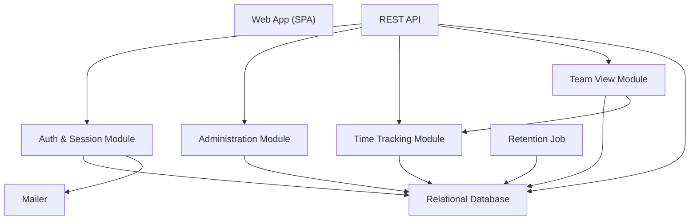
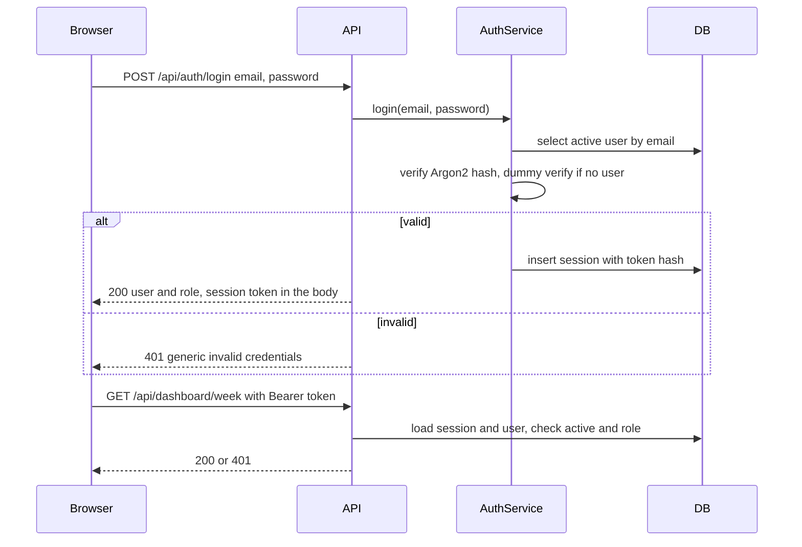
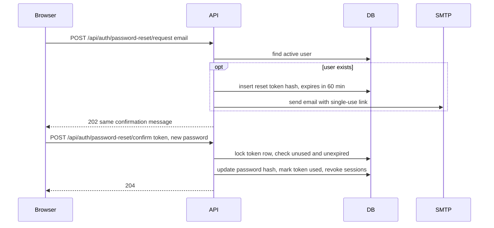
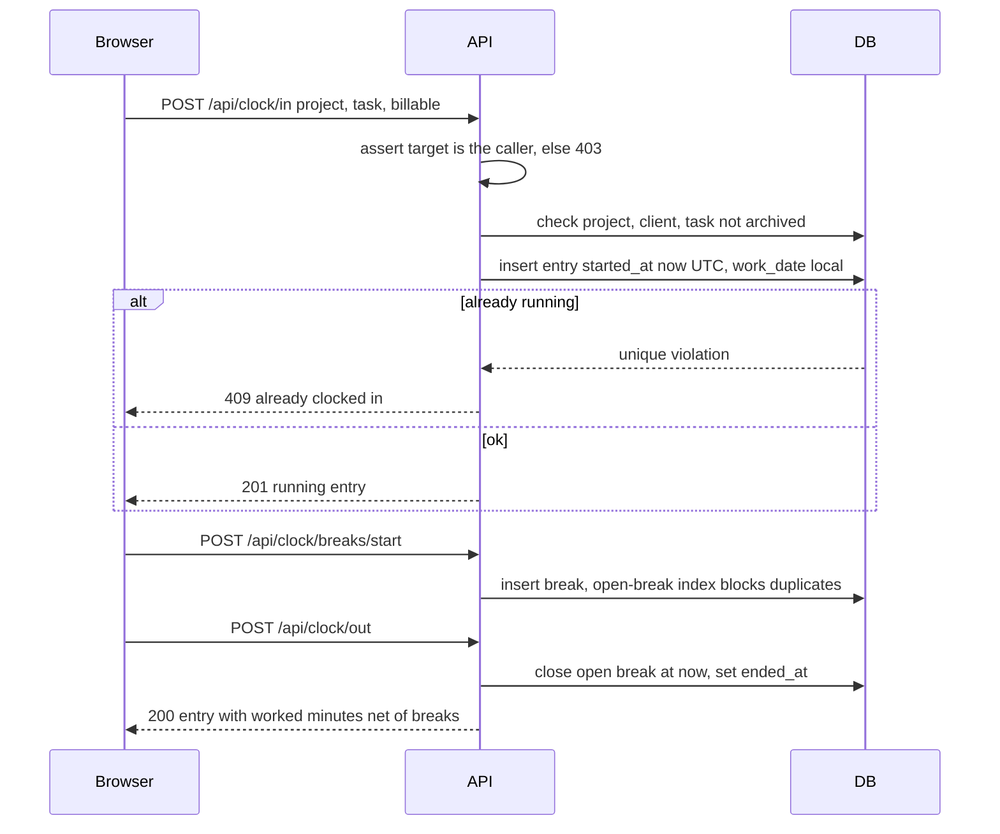
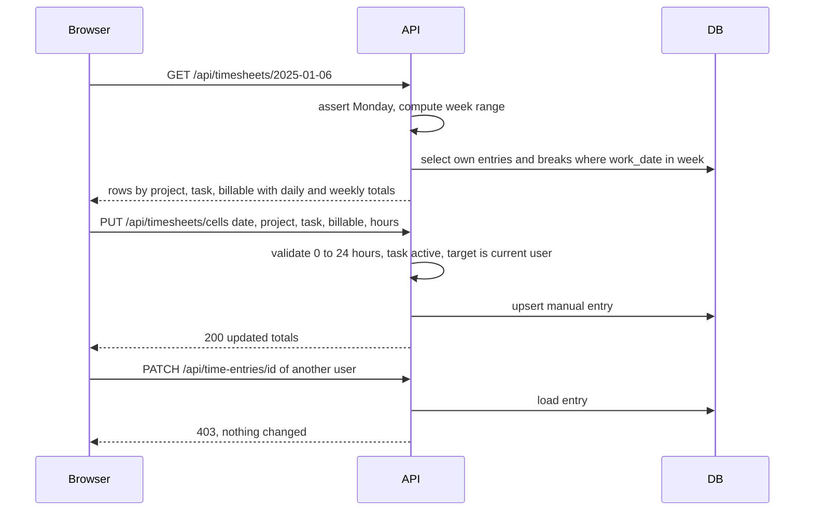
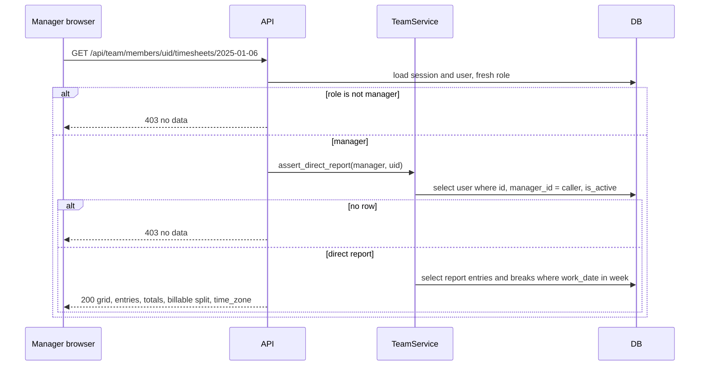
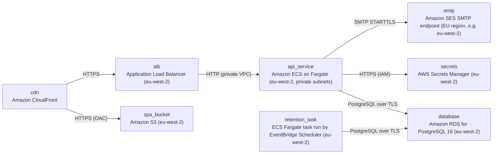

# Architecture

> Maintained by QuorQ AI SDLC. Text between `sdlc:auto` markers is regenerated; anything outside them is yours and is kept.

<!-- sdlc:auto:start narrative -->
## Overview

### ARCH-OVERVIEW · approved · source: architecture:summary

TimeTrack Pro V1 is a responsive React 19 SPA that calls a FastAPI 0.115 REST API backed by PostgreSQL 16. Everything is hosted in AWS London (eu-west-2) so personal data stays in the UK under GDPR / UK GDPR. The architecture status is approved, version 1.

- Status: approved; Version: 1.
- Stack: React 19 SPA -> FastAPI 0.115 REST API -> PostgreSQL 16.
- Hosting: AWS London (eu-west-2). Stated rationale: personal data stays in the UK, as GDPR and UK GDPR require.
- Auth:
  - Email and password sign-in, with passwords hashed using Argon2.
  - Server-side sessions using a Bearer token.
  - Every request re-reads the user's active status and role, so admin changes apply on the next request.
- System Admins manage:
  - users and manager assignments
  - clients
  - projects, with an hourly bill rate used for reporting only
  - tasks
- Employees:
  - Clock in and out with breaks, or fill a Monday-to-Sunday weekly timesheet.
  - Charge each entry to a project and task, marked billable or non-billable.
  - Edit or delete their own entries.
  - See a weekly dashboard.
- Time handling: timestamps are stored in UTC and shown in each user's IANA time zone.
- Password-reset email goes through the approved SMTP service (Amazon SES SMTP, EU region).

**Related:** US-001, US-004, US-005, US-006, US-013, US-016, US-020, US-021, NFR-006

### ARCH-CHG-001 · approved · source: architecture:what_changed

This revision adds a read-only Manager 'My team' view through a new team_service module and two GET endpoints. It also makes owner-only write enforcement explicit on all write routes. The only schema change is a partial index; no new tables are added.

Changes under CHG-001, EPIC-009, AC-050, AC-064 and AC-065:
1. New HLD module team_service (Team View Module) serves the read-only Manager 'My team' view.
2. Two new read-only endpoints:
   - GET /api/team/members: the caller's active direct reports, with name and time zone.
   - GET /api/team/members/{user_id}/timesheets/{week_start}: a report's Mon-Sun grid, entries with breaks, daily and weekly totals, billable / non-billable split, and the report's time zone label.
3. Every team request is checked server-side against fresh data:
   - The caller's role must be manager.
   - The target must be active, with manager_id equal to the caller.
   - Anything else returns 403 with no data. This covers reassignment, deactivation and role change (AC-059 to AC-062).
4. AC-064 and AC-058 are made explicit across all write routes:
   - Clock and timesheet-cell routes act only on the caller and refuse other targets with 403.
   - Entry edit, delete and fix-end routes stay owner-only, returning 403 otherwise.
   - No team write endpoints exist.
5. Partial index on users(manager_id) WHERE is_active. No new tables.
6. Web app changes:
   - New My team screens with no edit controls (AC-057).
   - Updated admin and Manager help sections (AC-050, AC-065).
7. Traceability and LLD:
   - New LLD critical path for the team view.
   - luxon and tzdata now also trace to US-021. These libraries are not otherwise described in the input.
- Unchanged: all other decisions, component ids, endpoint paths, deployment and runtime needs.

**Related:** CHG-001, EPIC-009, AC-050, AC-057, AC-058, AC-059, AC-060, AC-061, AC-062, AC-064, AC-065, US-020, US-021

### ARCH-SCOPE · approved · source: architecture:what_changed

Several capabilities in the project description are outside this delivery's architecture scope: approval, leave, labour rules, reports, payroll export, notifications and audit. Invoicing and payroll calculation are out of scope entirely.

- Outside this delivery scope (per architecture input):
  - timesheet approval
  - leave / time off
  - labour rules (overtime, missed breaks, compliance report)
  - reports
  - payroll export
  - notifications
  - audit
- Out of scope entirely: invoicing and payroll calculation.
- Bill rate is stored for reporting only.
- Difference with the project description:
  - The project description includes approval, leave, labour rules, reports, CSV and payroll export, in-app notifications and audit.
  - The architecture defers these.
  - Recorded as a scope difference. The input does not state which later delivery will cover them.

**Related:** CHG-001

### ARCH-COMP-web_spa · approved · source: architecture:component:web_spa

The Web App is an English-only, responsive React 19 (TypeScript) SPA. It covers sign-in, clock, timesheet, dashboard, admin screens, the read-only My team view and static help guides.

- Technology: React 19 (TypeScript).
- UI areas:
  - sign-in and password reset
  - clock and breaks
  - weekly timesheet and dashboard
  - admin screens (users, clients, projects, tasks)
  - read-only Manager 'My team' view:
    - direct-report list, with an empty state
    - a report's week grid, entries list, totals and billable split
  - static user, Manager and admin help guides
- My team view behaviour:
  - Renders with no add, edit, delete or clock controls (AC-057).
  - Labels the report's time zone (AC-056).
- Converts UTC times to the relevant user's time zone for display.
- Shows the My team navigation only when /api/auth/me reports the role as manager.

**Related:** AC-056, AC-057, US-020, US-021

### ARCH-COMP-api · approved · source: architecture:component:api

The REST API (FastAPI 0.115) hosts all HTTP endpoints, validates requests with Pydantic and checks the Bearer session token. It enforces role, ownership and reporting-line checks server-side on every request.

- Technology: FastAPI 0.115.
- Responsibilities:
  - HTTP endpoints
  - request validation (Pydantic)
  - Bearer session token check
- Enforces role-based access, ownership and reporting-line checks on the server for every request (NFR-003, AC-064).
- Contains the domain services for:
  - auth
  - users
  - catalog
  - clock
  - timesheet
  - team view

**Related:** NFR-003, AC-064

### ARCH-COMP-auth_service · approved · source: architecture:component:auth_service

The Auth & Session Module handles login, logout, Argon2 hashing, server-side sessions and single-use reset and set-password tokens. It provides get_current_user and require_role dependencies that re-read role and active status on every request.

- Login and logout.
- Argon2 password hashing.
- Server-side sessions.
- Issues single-use, time-limited reset and set-password tokens.
- Returns generic error and confirmation messages (NFR-002).
- Revokes sessions when a user is deactivated.
- Dependencies:
  - get_current_user
  - require_role
  - Both re-read role and active status on each request.

**Related:** NFR-002, US-001

### ARCH-COMP-admin_service · approved · source: architecture:component:admin_service

The Administration Module manages user accounts, manager assignment, clients, projects (with bill rate and default billable flag) and tasks with archiving. Manager assignment is the only thing that grants team access, and the module never alters existing time entries.

- User accounts: create, edit, deactivate.
- Manager assignment:
  - Must point to an active user with the Manager role.
  - It is the only thing that grants team access.
- Catalog:
  - clients
  - projects, with bill rate and default billable flag
  - tasks, with archiving
- Never alters existing time entries (NFR-014).

**Related:** NFR-014, US-004, US-005, US-006

### ARCH-COMP-time_service · approved · source: architecture:component:time_service

The Time Tracking Module handles clock in and out, breaks, fixing a running entry, manual weekly timesheet cells, own-entry edit and delete, and dashboard aggregates. All writes are restricted to the caller's own data, and it exposes a read-only get_week reused by the team view.

- Operations:
  - clock in and out
  - breaks
  - fixing a running entry
  - manual weekly timesheet cells
  - editing and deleting own entries
  - weekly dashboard aggregates
- All writes act only on the caller's own data. Any other target is refused with 403 (AC-058, AC-063, AC-064).
- Time calculations:
  - Durations are computed in UTC.
  - Local work dates use the subject user's time zone.
  - Weeks run Monday to Sunday.
- Exposes read-only get_week(subject_user, week_start), which team_service reuses.

**Related:** AC-058, AC-063, AC-064, US-013, US-016

### ARCH-COMP-team_service · approved · source: architecture:component:team_service

The Team View Module (new in CHG-001) provides a read-only Manager view of active direct reports and their weekly time. It enforces role = manager and the recorded reporting line against fresh database state before returning anything.

- Lists the caller's active direct reports: manager_id = caller and is_active.
- Returns a report's week by reusing time_service.get_week in the report's time zone.
- Before returning data, enforces:
  - role = manager
  - the recorded reporting line, checked against fresh DB state
- Refuses with 403 for (AC-059 to AC-062):
  - non-managers
  - non-reports
  - deactivated reports
  - unknown ids
- No write operations.
- Stated rationale: GDPR / UK GDPR data minimisation. A manager sees only direct reports' time data.

**Related:** EPIC-009, AC-059, AC-060, AC-061, AC-062, US-020, US-021

### ARCH-COMP-mailer · approved · source: architecture:component:mailer

The Mailer sends password-reset and set-password emails over SMTP through Amazon SES SMTP in the EU region.

- Technology: Python smtplib to Amazon SES SMTP (EU region).
- Uses the approved SMTP_* settings.
- Sends password-reset and set-password emails.

### ARCH-COMP-retention_job · approved · source: architecture:component:retention_job

The Retention Job is a scheduled CLI task that deletes time entries and breaks older than the configured retention period. The default period is 6 years.

- Implementation: a CLI task in the FastAPI 0.115 codebase.
- Runs on AWS ECS, triggered by Amazon EventBridge Scheduler.
- Deletes time entries and breaks older than the configured retention period.
- Default retention: 6 years (NFR-008).

**Related:** NFR-008

### ARCH-COMP-db · approved · source: architecture:component:db

PostgreSQL 16 on encrypted Amazon RDS is the system of record. Partial unique indexes enforce one running entry and one open break, and all timestamps are stored as timestamptz in UTC.

- Technology: PostgreSQL 16 on Amazon RDS, encrypted.
- System of record for:
  - users, including the manager_id reporting line
  - sessions and tokens
  - clients, projects and tasks
  - time entries and breaks
  - settings
- Partial unique indexes enforce one running entry and one open break.
- Partial index on users(manager_id) WHERE is_active (added in CHG-001).
- All timestamps are stored as timestamptz in UTC.

### ARCH-CP-SIGNIN · approved · source: architecture:critical_path:sign-in

Login verifies the Argon2 hash, returns a single generic error and issues a random session token used as a Bearer token. Every request then re-validates the session and the user's status and role from the database.

1. Login verifies the Argon2 hash. An unknown email and a wrong password get the same error.
2. Login creates a session row and returns a random session token in the response body.
3. The SPA sends the token as Authorization: Bearer.
4. Every request:
   - Loads the session and the user.
   - Rejects the request if the session is revoked or expired, or the user is inactive.
   - Reads the role fresh from the DB, so admin changes apply on the next request.

**Related:** US-001, NFR-002

### ARCH-CP-PWRESET · approved · source: architecture:critical_path:password-reset

A reset request always returns the same confirmation. A hashed, single-use token valid for 60 minutes is emailed if an active account exists. The same mechanism sets the first password for admin-created users.

1. A reset request always returns the same confirmation.
2. If an active account exists:
   - The API stores the hash of a random token that expires after 60 minutes.
   - It emails a link containing the token.
3. Confirming the reset:
   - Checks the token is unused and unexpired.
   - Enforces the password rules.
4. In one transaction, the API:
   - updates the password hash
   - marks the token used
   - revokes existing sessions
5. The same mechanism powers the set-password link when an admin creates a user.

**Related:** AC-009, US-004

### ARCH-CP-CLOCK · approved · source: architecture:critical_path:clock

Clock-in validates the catalog, resolves the billable default and inserts a running entry, with indexes preventing duplicate running entries and open breaks. Clock-out closes any open break, and worked minutes are computed in UTC. All clock routes act only on the caller.

Clock-in:
- Checks that the project, client and task are active.
- Resolves the billable default.
- Inserts an entry with started_at = now() UTC and work_date = the local date in the user's time zone.
- A partial unique index rejects a second running entry with 409.

Breaks:
- Break start inserts a break row.
- A partial unique index rejects a second open break.

Clock-out:
- Closes any open break at the clock-out time.
- Sets ended_at.
- Worked minutes = ended_at - started_at - sum of breaks.
- Computed in UTC, so results stay correct across DST changes.

Forgotten entries:
- GET /clock/status flags a running entry from an earlier day.
- PATCH /time-entries/{id}/end validates that end is after start.

Access:
- All clock routes act only on the caller.
- A request naming another user is refused with 403 before any write, so a Manager can never clock a report in or out (AC-058).

**Related:** AC-058, AC-031, AC-032

### ARCH-CP-TIMESHEET · approved · source: architecture:critical_path:timesheet

Weekly load returns a Monday-to-Sunday view that merges manual and clocked entries with totals. Saves upsert manual cells, and edits and deletes are strictly owner-only. get_week is parameterised by the subject user so the team view can reuse it.

Load (GET):
- Returns Monday to Sunday for the requested week. week_start must be a Monday.
- Merges manual cells with closed or running clock entries.
- Groups by project, task and billable.
- Includes daily and weekly totals.

Save cell:
- Upserts a manual entry with duration_minutes between 0 and 1440.
- Sending 0 deletes the entry.

Edit and delete:
- Load the entry and return 403 unless entry.user_id equals the caller.
- This applies equally to a Manager acting on a direct report's entry (AC-041, AC-058, AC-064).

Archived catalog items:
- Archived tasks and projects are rejected for new entries.
- They are still shown on existing entries.

Reuse: get_week is parameterised by the subject user, so the team view can reuse it read-only.

**Related:** US-013, AC-041, AC-058, AC-064

### ARCH-CP-TEAMVIEW · approved · source: architecture:critical_path:team-view

Both team routes first require a freshly loaded manager role. The list returns only id, name and time zone for active direct reports. The week route uses a single query to confirm the reporting line and returns 403 with an empty body otherwise. The data is presented in the report's time zone.

Role check:
- Both routes first run require_role('manager') against the role freshly loaded with the session.
- These callers get 403 (AC-060, AC-062):
  - Employee
  - Payroll Admin
  - System Admin
  - a former Manager whose role changed

List route:
- Selects users WHERE manager_id = caller.id AND is_active, ordered by name.
- Returns only id, full_name and time_zone (AC-052 to AC-054).

Week route:
- Calls assert_direct_report(caller, user_id): a single query on id, manager_id = caller and is_active.
- If no row is found, raises 403 with an empty body.
- Unknown ids get the same 403, so existence is not revealed (AC-059, AC-061, AC-062).
- A deactivated manager's sessions are already revoked, so their requests fail with 401 before reaching the route.
- Then calls time_service.get_week(report, week_start, include_entries=True).

Time zone handling:
- Day boundaries come from each entry's work_date, derived in the report's time zone.
- The response carries the report's time_zone.
- The SPA formats started_at, ended_at and breaks in that zone and labels it (AC-055, AC-056).

No write path:
- The router has only GET handlers.
- The SPA renders the view with no edit controls (AC-057).

**Related:** US-020, US-021, AC-052, AC-053, AC-054, AC-055, AC-056, AC-057, AC-059, AC-060, AC-061, AC-062

### ARCH-DATA-MODEL · approved · source: architecture:entities

The data model has nine tables covering users and sessions, password tokens, the client/project/task catalog, time entries with breaks, and app settings. No new tables were added in CHG-001.

- users: id, email, full_name, password_hash, role, time_zone, manager_id, is_active, created_at, updated_at
- sessions: id, user_id, token_hash, created_at, expires_at, revoked_at
- password_tokens: id, user_id, token_hash, purpose, expires_at, used_at
- clients: id, name, archived_at
- projects: id, client_id, name, hourly_bill_rate, default_billable, archived_at
- tasks: id, project_id, name, archived_at
- time_entries: id, user_id, project_id, task_id, source, billable, work_date, started_at, ended_at, duration_minutes, created_at, updated_at
- breaks: id, time_entry_id, started_at, ended_at
- app_settings: key, value

Indexes:
- Partial unique indexes enforce one running entry and one open break.
- Partial index on users(manager_id) WHERE is_active.

### ARCH-API-AUTH · approved · source: architecture:endpoints:auth

Five auth endpoints cover login, logout, current-user lookup, and password reset request and confirm.

- POST /api/auth/login: sign in (US-001). Returns a generic 401 on any failure.
- POST /api/auth/logout: revokes the current session so its token stops working (AC-003).
- GET /api/auth/me: returns the current user and role for routing to the role home page. The SPA shows My team navigation only when the role is manager.
- POST /api/auth/password-reset/request: requests a reset link. Always returns the same response (AC-009).
- POST /api/auth/password-reset/confirm: sets a new password with a single-use token. Also sets the first password after admin creation.

**Related:** US-001, AC-003, AC-009

### ARCH-API-ADMIN · approved · source: architecture:endpoints:admin

Admin endpoints manage users (including manager assignment and deactivation), clients, projects and tasks. Reassignment, role change and deactivation take effect on team access at the next request.

Users:
- GET /api/admin/users: lists users with role, manager and active status (AC-006).
- POST /api/admin/users: creates a user and emails a set-password link (US-004).
  - 409 on a duplicate email.
  - 422 per field on validation errors.
- PATCH /api/admin/users/{id}: edits name, role, manager or time zone (US-005, US-006).
  - The manager must be an active user with the manager role.
  - Changing manager_id moves team access to the new manager on the next request.
  - Changing a manager's role away from manager removes their team access (AC-061, AC-062).
- POST /api/admin/users/{id}/deactivate: deactivates the user and revokes their sessions.
  - Time entries are kept (AC-016).
  - The user drops out of their manager's team view (AC-053, AC-062).

Clients:
- GET /api/admin/clients: lists clients, including archived ones.
- POST /api/admin/clients: creates a client with a unique name (AC-017).
- PATCH /api/admin/clients/{id}: renames, archives or unarchives a client (AC-018).

Projects and tasks:
- POST /api/admin/projects: creates a project under a client with an hourly bill rate (reporting only) and a default billable flag (AC-019, AC-020).
- PATCH /api/admin/projects/{id}: edits name, rate or default billable, or archives. Existing entries are untouched (AC-021).
- POST /api/admin/projects/{id}/tasks: adds a task (AC-023).
- PATCH /api/admin/tasks/{id}: renames or archives a task (AC-024).

**Related:** US-004, US-005, US-006, AC-006, AC-016, AC-017, AC-018, AC-019, AC-020, AC-021, AC-023, AC-024, AC-053, AC-061, AC-062

### ARCH-API-CLOCK-TIME · approved · source: architecture:endpoints:clock-timesheet

Endpoints for the project picker, clock, breaks, timesheet cells, own-entry edit and delete, and the weekly dashboard. Every write is caller-only, and any other user target gets 403.

Project picker:
- GET /api/projects: active projects with active tasks and the billable default. The bill rate is not returned to non-admins.

Clock and breaks:
- GET /api/clock/status: running entry and open break, with a stale flag if the entry started on an earlier local day (AC-031).
- POST /api/clock/in: starts a running entry for the caller only (AC-025).
  - 409 if one is already running (AC-027).
  - 403 if the body names another user_id (AC-058).
- POST /api/clock/breaks/start: starts a break on the caller's running entry.
  - 409 if a break is already open (AC-030).
  - 403 for another user.
- POST /api/clock/breaks/end: ends the caller's open break (AC-028). 403 for another user.
- POST /api/clock/out: closes the caller's open break and running entry (AC-026, AC-029). 403 for another user.

Entries:
- PATCH /api/time-entries/{id}/end: sets the end time of a forgotten running entry.
  - 422 if the end is before the start (AC-032).
  - 403 for any entry not owned by the caller, including a direct report's (AC-058, AC-064).
- PATCH /api/time-entries/{id}: edits day, hours, project, task, billable flag or times of an own entry (AC-039). Managers get 403 for reports' entries (AC-058).
- DELETE /api/time-entries/{id}: deletes an own entry and its breaks (AC-040). Managers get 403 for reports' entries (AC-058).

Timesheet and dashboard:
- GET /api/timesheets/{week_start}: the caller's own Mon-Sun week with manual and clocked entries and totals (US-013). 422 if week_start is not a Monday.
- PUT /api/timesheets/cells: upserts a manual hours cell (0-24 h) for the caller only.
  - 0 hours deletes the cell.
  - 403 if the body names another user_id (AC-058, AC-064).
- GET /api/dashboard/week: current local week totals, per-day hours and billable vs non-billable split (US-016).

**Related:** US-013, US-016, AC-025, AC-026, AC-027, AC-028, AC-029, AC-030, AC-031, AC-032, AC-039, AC-040, AC-058, AC-064

### ARCH-API-TEAM · approved · source: architecture:endpoints:team

Two new read-only team endpoints list a manager's active direct reports and return a report's week in the report's time zone. No team write endpoints exist.

- GET /api/team/members (NEW):
  - Lists the caller's active direct reports (manager_id = caller, is_active = true) (US-020, AC-052 to AC-054).
  - An empty list drives the empty state.
  - Other roles get 403 (AC-060).
- GET /api/team/members/{user_id}/timesheets/{week_start} (NEW):
  - Returns a direct report's read-only Mon-Sun week (US-021).
  - Groups data on the report's local work dates and labels it with the report's time zone (AC-055, AC-056).
  - Returns 403 with no data if (AC-059 to AC-062):
    - the caller is not a manager
    - the user is not their active direct report
    - the user does not exist
  - Returns 422 if week_start is not a Monday.
- No team write endpoints exist.

**Related:** US-020, US-021, AC-052, AC-053, AC-054, AC-055, AC-056, AC-059, AC-060, AC-061, AC-062

### ARCH-DEPLOY · approved · source: architecture:deployment_nodes

Deployment runs on AWS: CloudFront and private S3 for the SPA, an ALB in front of ECS Fargate for the API, and scheduled Fargate tasks for retention. Encrypted RDS PostgreSQL, Secrets Manager and SES SMTP complete the setup, primarily in eu-west-2.

- cdn: Amazon CloudFront edge distribution.
  - TLS 1.2+.
  - Routes /api/* to the ALB and everything else to S3.
- spa_bucket: Amazon S3 (eu-west-2) holding the static React 19 build.
  - Private bucket with origin access control.
  - SSE-S3 encryption.
- alb: Application Load Balancer (eu-west-2) with an HTTPS listener and ACM certificate.
- api_service: ECS on Fargate (eu-west-2, private subnets).
  - FastAPI 0.115 container served by uvicorn.
  - Includes the team view module.
- retention_task: ECS Fargate task run daily by EventBridge Scheduler (eu-west-2). Same image, running the retention CLI command.
- database: Amazon RDS for PostgreSQL 16 (eu-west-2).
  - db.t4g.small in dev.
  - KMS storage encryption and TLS enforced.
  - Encrypted automated backups.
- secrets: AWS Secrets Manager (eu-west-2). Holds DB credentials and SMTP_USER / SMTP_PASSWORD, injected into the ECS task.
- smtp: Amazon SES SMTP endpoint (EU region, e.g. eu-west-2). SMTP over STARTTLS on port 587.

**Related:** NFR-006, NFR-008

### ARCH-TECH-FRONTEND · approved · source: architecture:technology:frontend

React 19 was chosen over server-rendered templates from the API. The product owner approved the choice.

- Choice: React 19 (TypeScript), responsive SPA.
- Alternative considered: server-rendered templates from the API.
- Approved by: the product owner.
- Covers clock, timesheet, dashboard, admin screens and the read-only My team view.
- Deployed as static files on S3 and CloudFront in eu-west-2.
- Rationale stated: all Monday-peak interaction runs client-side.

### ARCH-TECH-BACKEND · approved · source: architecture:technology:backend

FastAPI 0.115 was chosen over other Python REST frameworks. Rationale: Pydantic field validation and reusable dependencies for access checks.

- Choice: FastAPI 0.115. Status: approved (approver not named).
- Alternative considered: other Python REST frameworks.
- Rationale:
  - Pydantic gives field-level validation for hours, rates and emails (NFR-013).
  - Dependencies implement session, role, ownership and reporting-line checks on every route.
  - The team view's access rule is therefore one reusable dependency.
- The same image also runs the retention job.

**Related:** NFR-013

### ARCH-TECH-DATABASE · approved · source: architecture:technology:database

PostgreSQL 16 on RDS (eu-west-2, KMS-encrypted) was chosen, with no alternatives needed. Its partial indexes and the manager_id self-reference support the key invariants and the direct-report check.

- Choice: PostgreSQL 16. Status: approved (approver not named).
- Alternatives: none needed beyond PostgreSQL.
- Hosting: Amazon RDS in eu-west-2 with KMS encryption.
- Rationale:
  - timestamptz stores UTC.
  - Partial unique indexes enforce one running entry and one open break.
  - The users.manager_id self-reference plus a partial index answers the direct-report check in one indexed query.
  - Weekly totals are simple GROUP BY queries on (user_id, work_date).

### ARCH-TECH-CLOUD · approved · source: architecture:technology:cloud

AWS was chosen because all required services are available in the UK and EU regions, which meets data-residency needs. S3 and CloudFront were added only to host the static SPA build.

- Choice: AWS. Status: approved (approver not named).
- Alternatives: none (residency met in eu-west-2 or eu-west-1).
- Rationale:
  - ECS Fargate, RDS, S3, CloudFront, Secrets Manager, EventBridge Scheduler and SES are available in UK and EU regions.
  - This meets NFR-006 and GDPR / UK GDPR.
- S3 and CloudFront were added only to host the static SPA build, because the approved components have no static web host of their own.

**Related:** NFR-006

### ARCH-OPEN-NOTES · draft · source: architecture:summary; architecture:technology:cloud; architecture:deployment_nodes:smtp

This entry records wording differences found within the architecture input, for human review. Nothing has been resolved by the Documentation Agent.

Data residency wording differs across the input:
- Summary: everything is hosted in AWS London (eu-west-2) so personal data stays in the UK.
- Cloud decision: residency is met in 'eu-west-2 or eu-west-1'. eu-west-1 is Ireland.
- Mailer / SMTP node: Amazon SES SMTP in the 'EU region, e.g. eu-west-2'.
- Both versions are recorded here. Please confirm whether any component (especially SES) may run outside the UK.

Versioning wording differs:
- The input states Version: 1.
- It also describes 'WHAT CHANGED in this revision (CHG-001)'.
- The prior version is not provided.

Traceability gap:
- luxon and tzdata are said to now also trace to US-021.
- Their role is not otherwise described in the components or technology decisions.

**Related:** NFR-006, CHG-001
<!-- sdlc:auto:end narrative -->

<!-- sdlc:auto:start building-blocks -->
## Building Block View

| ID | Name | Technology | Responsibility | Depends on |
|---|---|---|---|---|
| web_spa | Web App (SPA) | React 19 (TypeScript) | Provides the English-only responsive UI for these areas: - sign-in and password reset - clock and breaks - weekly timesheet and dashboard - admin screens (users, clients, projects, tasks) - the read-only Manager "My team" view: a direct-report list with an empty state, and a report's week grid, entries list, totals and billable split - the static user, Manager and admin help guides The My team view renders with no add, edit, delete or clock controls (AC-057) and labels the report's time zone (AC-056). The app converts UTC times to the relevant user's time zone for display. | — |
| api | REST API | FastAPI 0.115 | Hosts the HTTP endpoints, validates requests (Pydantic) and checks the Bearer session token. Enforces role-based access, ownership and reporting-line checks on the server for every request (NFR-003, AC-064). Contains the domain services for auth, users, catalog, clock, timesheet and team view. | auth_service, admin_service, time_service, team_service, db |
| auth_service | Auth & Session Module | FastAPI 0.115 module | Handles login and logout, Argon2 password hashing and server-side sessions. Issues single-use, time-limited reset and set-password tokens. Returns generic error and confirmation messages (NFR-002). Revokes sessions when a user is deactivated. Provides get_current_user and require_role dependencies, which re-read role and active status on each request. | db, mailer |
| admin_service | Administration Module | FastAPI 0.115 module | Manages user accounts (create, edit, deactivate) and manager assignment, which must point to an active Manager. Manager assignment is the only thing that grants team access. Manages clients, projects with bill rate and default billable flag, and tasks with archiving. Never alters existing time entries (NFR-014). | db |
| time_service | Time Tracking Module | FastAPI 0.115 module | Handles clock in and out, breaks, and fixing a running entry. Handles manual weekly timesheet cells, editing and deleting own entries, and the weekly dashboard aggregates. All write operations act only on the caller's own data and refuse any other target with 403 (AC-058, AC-063, AC-064). Computes durations in UTC and local work dates in the subject user's time zone, with weeks running Monday to Sunday. Exposes a read-only get_week(subject_user, week_start) reused by the team view. | db |
| team_service | Team View Module | FastAPI 0.115 module | Read-only Manager team view (EPIC-009). Lists the caller's active direct reports (manager_id = caller, is_active). Returns a direct report's week by reusing time_service.get_week in the report's time zone. Before returning anything, it enforces role = manager and the recorded reporting line against fresh database state, and refuses with 403 for non-managers, non-reports, deactivated reports or unknown ids (AC-059 to AC-062). It offers no write operations. Under GDPR/UK GDPR data minimisation, a manager sees only direct reports' time data. | db, time_service |
| mailer | Mailer | Python smtplib to SMTP server (Amazon SES SMTP, EU region) | Sends password-reset and set-password emails over SMTP using the approved SMTP_* settings. | — |
| retention_job | Retention Job | FastAPI 0.115 codebase CLI task on AWS ECS, triggered by Amazon EventBridge Scheduler | Runs on a schedule and deletes time entries and breaks older than the configured retention period (default 6 years, NFR-008). | db |
| db | Relational Database | PostgreSQL 16 (Amazon RDS, encrypted) | System of record for users (including the manager_id reporting line), sessions, tokens, clients, projects, tasks, time entries, breaks and settings. Partial unique indexes enforce one running entry and one open break. Stores all timestamps as timestamptz in UTC. | — |

<!-- sdlc:auto:end building-blocks -->

<!-- sdlc:auto:start runtime -->
## Runtime View

### Sign-in and per-request session check

Login verifies the Argon2 hash and gives the same error for an unknown email or a wrong password. It creates a session row and returns a random session token in the response body, which the SPA sends as Authorization: Bearer. Every request loads the session and user, and rejects the request if the session is revoked or expired or the user is inactive. The role is read fresh from the database on each request, so admin changes apply on the next request.

- **Components:** web_spa, api, auth_service, db
- **Modules:** app/auth/router.py, app/auth/service.py, app/auth/deps.py, app/auth/passwords.py
- **Key functions:** login(email, password) -> Session, verify_password(hash, password) -> bool, get_current_user(request) -> User, require_role(*roles), logout(session_id)

### Password reset by email

A reset request always returns the same confirmation. If an active account exists, the API stores the hash of a random token that expires after 60 minutes and emails a link. Confirming the reset checks that the token is unused and unexpired and enforces the password rules. In one transaction it updates the hash, marks the token used and revokes existing sessions. The same mechanism powers the set-password link when an admin creates a user.

- **Components:** web_spa, api, auth_service, mailer, db
- **Modules:** app/auth/reset.py, app/mail/smtp.py
- **Key functions:** request_reset(email), issue_token(user_id, purpose, ttl), confirm_reset(token, new_password), send_mail(to, subject, body)

### Clock in, breaks and clock out

Clock-in checks that the project, client and task are active and resolves the billable default. It inserts a clock entry with started_at = now() UTC and work_date set to the local date in the user's time zone. A partial unique index rejects a second running entry with 409. A break start inserts a break row, and a partial unique index rejects a second open break.

Clock-out closes any open break at the clock-out time and sets ended_at. Worked minutes equal ended_at minus started_at minus the sum of breaks, computed in UTC so the result stays correct across daylight-saving changes. A running entry from an earlier day is flagged on GET /clock/status, and PATCH /time-entries/{id}/end validates that the end time is after the start time.

All clock routes act only on the caller. Any request that names another user is refused with 403 before any write, so a Manager can never clock a report in or out (AC-058).

- **Components:** web_spa, api, time_service, db
- **Modules:** app/time/clock.py, app/time/router.py, app/time/tz.py, app/auth/deps.py
- **Key functions:** clock_in(user, project_id, task_id, billable), start_break(user), end_break(user), clock_out(user), fix_running_entry(user, entry_id, ended_at), worked_minutes(entry) -> int, local_work_date(utc_ts, tz) -> date, assert_self_target(user, payload)

### Weekly timesheet load and save

GET returns Monday to Sunday for the requested week, which must start on a Monday. It merges manual cells and closed or running clock entries, grouped by project, task and billable, with daily and weekly totals. Saving a cell upserts a manual entry with duration_minutes between 0 and 1440, and sending 0 deletes the entry.

Edits and deletes load the entry and return 403 unless entry.user_id equals the caller. This applies equally to a Manager acting on a direct report's entry (AC-041, AC-058, AC-064). Archived tasks and projects are rejected for new entries but still shown on existing ones.

get_week is parameterised by the subject user so the team view can reuse it read-only.

- **Components:** web_spa, api, time_service, db
- **Modules:** app/time/timesheet.py, app/time/dashboard.py
- **Key functions:** get_week(subject_user, week_start, include_entries=False) -> WeekView, upsert_cell(user, work_date, project_id, task_id, billable, hours), update_entry(user, entry_id, patch), delete_entry(user, entry_id), assert_owner(user, entry), week_summary(user, today_local) -> Dashboard

### Manager team view with reporting-line check

Both team routes first run require_role('manager') against the role freshly loaded with the session. Employee, Payroll Admin and System Admin callers, and a former Manager whose role changed, get 403 (AC-060, AC-062).

The list route selects users WHERE manager_id = caller.id AND is_active, ordered by name, and returns only id, full_name and time_zone (AC-052 to AC-054).

The week route calls assert_direct_report(caller, user_id) with a single query on id, manager_id = caller and is_active. If no row is found it raises 403 with an empty body. The same 403 is used for unknown ids so existence is not revealed (AC-059, AC-061, AC-062). A deactivated manager's sessions are already revoked, so their requests fail with 401 before reaching the route.

The route then calls time_service.get_week(report, week_start, include_entries=True). Day boundaries come from each entry's work_date, which was derived in the report's time zone. The response carries the report's time_zone so the SPA formats started_at, ended_at and breaks in that zone and labels it (AC-055, AC-056).

The router has only GET handlers, so no team write path exists. The SPA renders the view with no edit controls (AC-057).

- **Components:** web_spa, api, auth_service, team_service, time_service, db
- **Modules:** app/team/router.py, app/team/service.py, app/auth/deps.py, app/time/timesheet.py
- **Key functions:** list_direct_reports(manager) -> list[TeamMember], assert_direct_report(manager, user_id) -> User, get_team_week(manager, user_id, week_start) -> TeamWeekView, require_role('manager')

<!-- sdlc:auto:end runtime -->

<!-- sdlc:auto:start deployment-view -->
## Deployment View

| Name | Service | Runtime | Scaling | Environment |
|---|---|---|---|---|
| cdn | Amazon CloudFront | Edge distribution, TLS 1.2+, routes /api/* to the ALB and everything else to S3 | Managed | dev |
| spa_bucket | Amazon S3 (eu-west-2) | Static build of React 19, private bucket with origin access control, SSE-S3 | Managed | dev |
| alb | Application Load Balancer (eu-west-2) | HTTPS listener with an ACM certificate | Managed | dev |
| api_service | Amazon ECS on Fargate (eu-west-2, private subnets) | FastAPI 0.115 container served by uvicorn, including the team view module | 1 task in dev. 2 to 4 tasks with CPU autoscaling in prod for the Monday peak (500 users) | dev |
| retention_task | ECS Fargate task run by EventBridge Scheduler (eu-west-2) | Same FastAPI 0.115 image, retention CLI command, daily | Single run | dev |
| database | Amazon RDS for PostgreSQL 16 (eu-west-2) | db.t4g.small in dev, KMS storage encryption, TLS enforced, encrypted automated backups | Vertical. Multi-AZ in prod | dev |
| secrets | AWS Secrets Manager (eu-west-2) | Holds DB credentials and SMTP_USER/SMTP_PASSWORD, injected into the ECS task | Managed | dev |
| smtp | Amazon SES SMTP endpoint (EU region, e.g. eu-west-2) | SMTP over STARTTLS, port 587 | Managed | dev |

| Source | Target | Protocol |
|---|---|---|
| cdn | spa_bucket | HTTPS (OAC) |
| cdn | alb | HTTPS |
| alb | api_service | HTTP (private VPC) |
| api_service | database | PostgreSQL over TLS |
| retention_task | database | PostgreSQL over TLS |
| api_service | secrets | HTTPS (IAM) |
| api_service | smtp | SMTP STARTTLS |

<!-- sdlc:auto:end deployment-view -->

<!-- sdlc:auto:start decisions -->
## Architecture Decisions

| Layer | Choice | ADR |
|---|---|---|
| Frontend | React 19 | [ADR-0001](adr/frontend.md) |
| Backend | FastAPI 0.115 | [ADR-0002](adr/backend.md) |
| Database | PostgreSQL 16 | [ADR-0003](adr/database.md) |
| Cloud | AWS | [ADR-0004](adr/cloud.md) |
<!-- sdlc:auto:end decisions -->

<!-- sdlc:auto:start links -->
## Related Documents

- [Data Model](data-model.md)
- [API Specification](api/openapi.yaml)
- [Architecture Decision Records](adr/README.md)
<!-- sdlc:auto:end links -->
