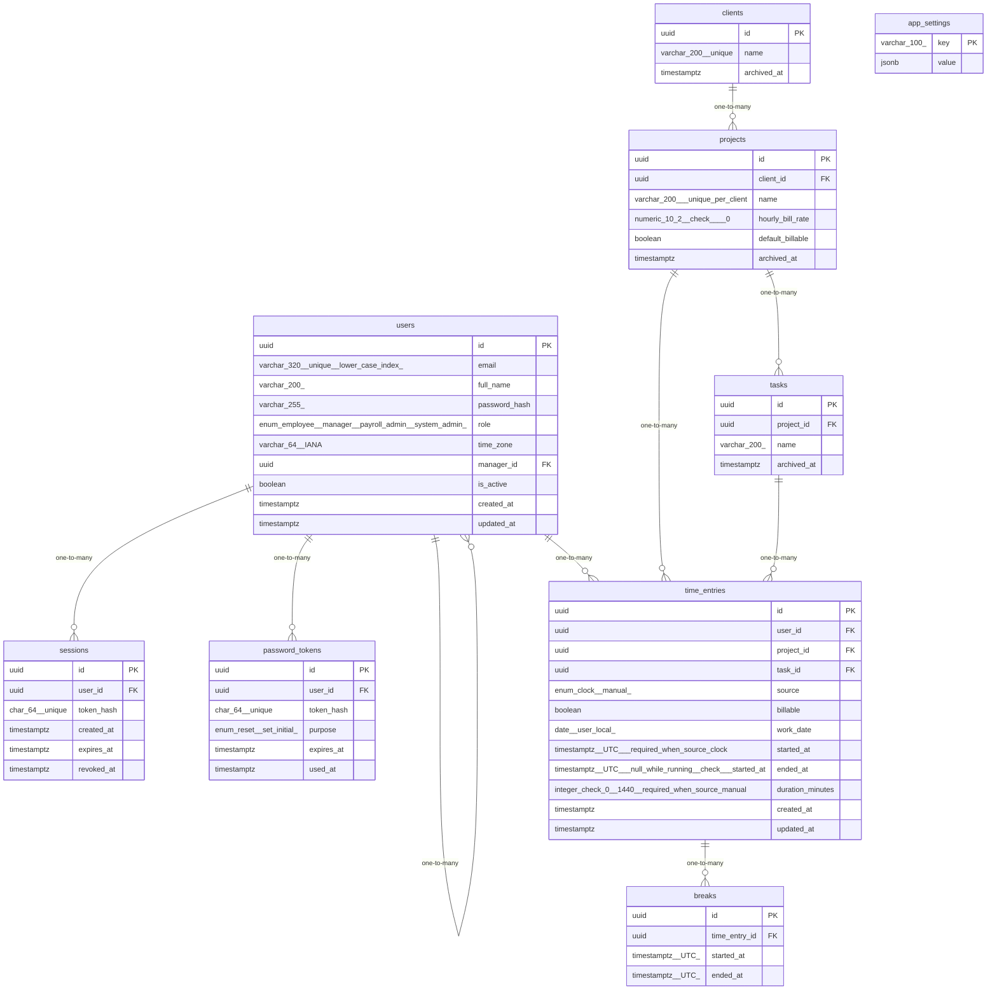

# Data Model

<!-- sdlc:auto:start entities -->
### users

| Field | Type | PK | FK | Nullable |
|---|---|---|---|---|
| id | uuid | True | — | False |
| email | varchar(320) unique (lower-case index) | False | — | False |
| full_name | varchar(200) | False | — | False |
| password_hash | varchar(255) | False | — | True |
| role | enum(employee, manager, payroll_admin, system_admin) | False | — | False |
| time_zone | varchar(64) IANA | False | — | False |
| manager_id | uuid | False | users.id | True |
| is_active | boolean | False | — | False |
| created_at | timestamptz | False | — | False |
| updated_at | timestamptz | False | — | False |

### sessions

| Field | Type | PK | FK | Nullable |
|---|---|---|---|---|
| id | uuid | True | — | False |
| user_id | uuid | False | users.id | False |
| token_hash | char(64) unique | False | — | False |
| created_at | timestamptz | False | — | False |
| expires_at | timestamptz | False | — | False |
| revoked_at | timestamptz | False | — | True |

### password_tokens

| Field | Type | PK | FK | Nullable |
|---|---|---|---|---|
| id | uuid | True | — | False |
| user_id | uuid | False | users.id | False |
| token_hash | char(64) unique | False | — | False |
| purpose | enum(reset, set_initial) | False | — | False |
| expires_at | timestamptz | False | — | False |
| used_at | timestamptz | False | — | True |

### clients

| Field | Type | PK | FK | Nullable |
|---|---|---|---|---|
| id | uuid | True | — | False |
| name | varchar(200) unique | False | — | False |
| archived_at | timestamptz | False | — | True |

### projects

| Field | Type | PK | FK | Nullable |
|---|---|---|---|---|
| id | uuid | True | — | False |
| client_id | uuid | False | clients.id | False |
| name | varchar(200), unique per client | False | — | False |
| hourly_bill_rate | numeric(10,2) check >= 0 | False | — | False |
| default_billable | boolean | False | — | True |
| archived_at | timestamptz | False | — | True |

### tasks

| Field | Type | PK | FK | Nullable |
|---|---|---|---|---|
| id | uuid | True | — | False |
| project_id | uuid | False | projects.id | False |
| name | varchar(200) | False | — | False |
| archived_at | timestamptz | False | — | True |

### time_entries

| Field | Type | PK | FK | Nullable |
|---|---|---|---|---|
| id | uuid | True | — | False |
| user_id | uuid | False | users.id | False |
| project_id | uuid | False | projects.id | False |
| task_id | uuid | False | tasks.id | False |
| source | enum(clock, manual) | False | — | False |
| billable | boolean | False | — | False |
| work_date | date (user-local) | False | — | False |
| started_at | timestamptz (UTC), required when source=clock | False | — | True |
| ended_at | timestamptz (UTC), null while running, check > started_at | False | — | True |
| duration_minutes | integer check 0..1440, required when source=manual | False | — | True |
| created_at | timestamptz | False | — | False |
| updated_at | timestamptz | False | — | False |

### breaks

| Field | Type | PK | FK | Nullable |
|---|---|---|---|---|
| id | uuid | True | — | False |
| time_entry_id | uuid | False | time_entries.id | False |
| started_at | timestamptz (UTC) | False | — | False |
| ended_at | timestamptz (UTC) | False | — | True |

### app_settings

| Field | Type | PK | FK | Nullable |
|---|---|---|---|---|
| key | varchar(100) | True | — | False |
| value | jsonb | False | — | False |
<!-- sdlc:auto:end entities -->

<!-- sdlc:auto:start relationships -->
| Source | Target | Type |
|---|---|---|
| users | users | one-to-many |
| users | sessions | one-to-many |
| users | password_tokens | one-to-many |
| clients | projects | one-to-many |
| projects | tasks | one-to-many |
| users | time_entries | one-to-many |
| projects | time_entries | one-to-many |
| tasks | time_entries | one-to-many |
| time_entries | breaks | one-to-many |
<!-- sdlc:auto:end relationships -->

<!-- sdlc:auto:start er-diagram -->

<!-- sdlc:auto:end er-diagram -->
