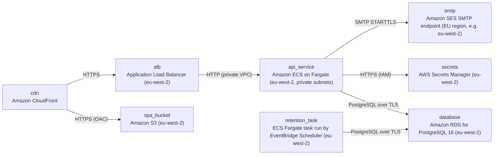

# Deployment Guide

> Maintained by QuorQ AI SDLC. Text between `sdlc:auto` markers is regenerated; anything outside them is yours and is kept.

<!-- sdlc:auto:start how-it-deploys -->
Pushes to `main` run `.github/workflows/deploy.yml`, which builds the API image (if there is a backend) and deploys the SPA to AWS Amplify. Commits touching only `docs/sdlc/**` don't deploy. Deployments can also be started from the platform's Deployment tab.
<!-- sdlc:auto:end how-it-deploys -->

<!-- sdlc:auto:start environments -->
| Name | Service | Runtime | Scaling | Environment |
|---|---|---|---|---|
| cdn | Amazon CloudFront | Edge distribution, TLS 1.2+, routes /api/* to the ALB and everything else to S3 | Managed | dev |
| spa_bucket | Amazon S3 (eu-west-2) | Static build of React 19, private bucket with origin access control, SSE-S3 | Managed | dev |
| alb | Application Load Balancer (eu-west-2) | HTTPS listener with an ACM certificate | Managed | dev |
| api_service | Amazon ECS on Fargate (eu-west-2, private subnets) | FastAPI 0.115 container served by uvicorn | 1 task in dev. 2 to 4 tasks with CPU autoscaling in prod for the Monday peak (500 users) | dev |
| retention_task | ECS Fargate task run by EventBridge Scheduler (eu-west-2) | Same FastAPI 0.115 image, retention CLI command, daily | Single run | dev |
| database | Amazon RDS for PostgreSQL 16 (eu-west-2) | db.t4g.small in dev, KMS storage encryption, TLS enforced, encrypted automated backups | Vertical. Multi-AZ in prod | dev |
| secrets | AWS Secrets Manager (eu-west-2) | Holds DB credentials and SMTP_USER/SMTP_PASSWORD, injected into the ECS task | Managed | dev |
| smtp | Amazon SES SMTP endpoint (EU region, e.g. eu-west-2) | SMTP over STARTTLS, port 587 | Managed | dev |
<!-- sdlc:auto:end environments -->

<!-- sdlc:auto:start live -->
**Frontend URL:** https://p856624deec93.d3j61xaup4zgrx.amplifyapp.com

**Backend URL:** https://44-240-155-47.sslip.io/apps/856624deec93/

**Database:** PostgreSQL · app

**Version:** 7a76bf8d64bf

**Commit:** `7a76bf8`

**Finished:** 2026-11-08
<!-- sdlc:auto:end live -->

<!-- sdlc:auto:start topology -->

<!-- sdlc:auto:end topology -->
